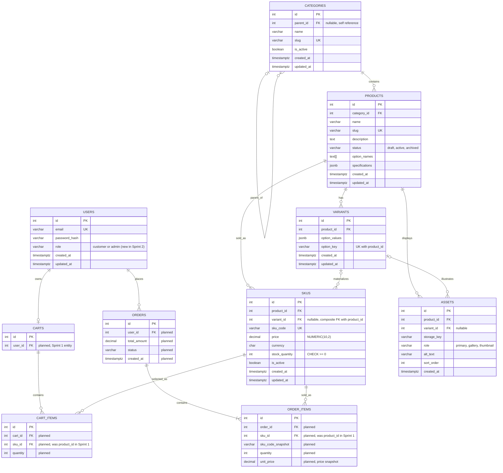

# Sprint 2: Catalog Data Foundation

**Course:** E-Commerce | **Sprint length:** 15 days | **Code:** [`/backend`](../backend) | **Setup:** [`backend/README.md`](../backend/README.md)

---

## 1. Sprint goal and scope boundary

**Goal:** given a product catalog administrator, the system persists categories, products, variants and SKUs without losing identity, relationship, price or inventory meaning.

| In scope (implemented and tested) | Out of scope (Sprint 3 or later) |
|---|---|
| Category tree with stable ids, unique slugs, cycle prevention | Dynamic specifications beyond the stored JSONB column |
| Product create / edit / archive with status and category | Asset upload and delivery (table exists, no endpoints) |
| Variants (valid option combinations) and SKUs (code, price, stock, availability) | Public catalog search and publication workflows |
| Authenticated administrator CRUD for the above | Payment gateway, orders, shipping, shopper checkout |
| Constraints, migrations, seed data, automated tests | Cart and order tables (shown in the ERD as *planned* only) |

The `assets` table and the `specifications` column exist so the data model is complete, but no Sprint 2 endpoint uploads assets or exposes specification search; they are **not** claimed as Sprint 2 functionality.

---

## 2. Sprint 1 decisions reused or changed

Reference: [`docs/SPRINT_1.md`](./SPRINT_1.md).

| Sprint 1 decision | Sprint 2 status | Why |
|---|---|---|
| Domain: apparel; persona wants accurate size availability | **Reused.** Variants model size/color, SKUs carry per-size stock | Directly addresses the Sprint 1 pain point (items shown in stock that are not) |
| Stack: Node.js / Express, PostgreSQL | **Reused.** `pg` driver, plain SQL migrations | Relational integrity needs: FKs, CHECKs, triggers |
| Auth: bcrypt + JWT | **Reused.** `POST /api/v1/auth/login` issues an HS256 JWT; passwords stored with bcrypt | Registration endpoint stays in the Sprint 3+ backlog; Sprint 2 only needs an administrator |
| ERD: `products` held `size`, `color`, `price`, `stock_quantity` | **Changed.** Those columns moved off `products`: option values live on `variants`, price and stock on `skus` | A shirt in two colors and three sizes has six prices and six stock counts; one product row cannot hold that |
| ERD: `cart_items.product_id`, `order_items.product_id` | **Changed (planned).** Both will reference `skus.id` instead | A cart or order line must name the sellable unit, not the product family. `order_items` will also snapshot `unit_price` and `sku_code` |
| ERD: `users` had no role | **Changed.** Added `users.role` (`customer` / `admin`) | Needed for administrative authorization (CAT06) |
| Timestamps: `TIMESTAMP` | **Changed.** `TIMESTAMPTZ` | Avoids time-zone ambiguity |
| Redis caching (optional) | **Not used yet** | Nothing to cache until public reads exist (Sprint 3) |

---

## 3. Updated ERD and data dictionary

Entities marked *planned* in the diagram (Carts, Cart_Items, Orders, Order_Items) are Sprint 1 entities that Sprint 3+ will build; Sprint 2 only fixes how they will connect to the catalog (through `skus`).



A rendered copy is committed at [`img/sprint2-erd.png`](./img/sprint2-erd.png).

### 3.1 Relationships, cardinality and delete/update policy

| Relationship | Cardinality | FK column(s) | ON DELETE | ON UPDATE | Rationale |
|---|---|---|---|---|---|
| Category → Category (parent) | 0..1 : 0..N | `categories.parent_id` | RESTRICT | CASCADE | A category with children cannot be hard-deleted; deactivate instead |
| Category → Product | 1 : 0..N | `products.category_id` | RESTRICT | CASCADE | Products are never orphaned |
| Product → Variant | 1 : 0..N | `variants.product_id` | RESTRICT | CASCADE | Catalog history is archived, not erased |
| Product → SKU | 1 : 0..N | `skus.product_id` | RESTRICT | CASCADE | Future order lines must keep a valid SKU |
| Variant → SKU | 0..1 : 0..N | `(skus.variant_id, skus.product_id)` → `(variants.id, variants.product_id)` | RESTRICT | CASCADE | Composite key forces a SKU's variant to belong to the **same product** |
| Product → Asset | 1 : 0..N | `assets.product_id` | CASCADE | CASCADE | Assets are dependent content |
| Variant → Asset | 0..1 : 0..N | `(assets.variant_id, assets.product_id)` | CASCADE | CASCADE | Same composite rule as SKUs |
| User → Cart *(planned)* | 1 : 0..1 | `carts.user_id` | CASCADE | CASCADE | A cart belongs to one user |
| Cart → Cart_Item *(planned)* | 1 : 0..N | `cart_items.cart_id` | CASCADE | CASCADE | Items die with their cart |
| SKU → Cart_Item *(planned)* | 1 : 0..N | `cart_items.sku_id` | RESTRICT | CASCADE | A SKU in a cart cannot be hard-deleted |
| User → Order *(planned)* | 1 : 0..N | `orders.user_id` | RESTRICT | CASCADE | Order history is kept |
| Order → Order_Item *(planned)* | 1 : 1..N | `order_items.order_id` | CASCADE | CASCADE | Items die with their order |
| SKU → Order_Item *(planned)* | 1 : 0..N | `order_items.sku_id` | RESTRICT | CASCADE | Sold SKUs can never be hard-deleted |

### 3.2 Data dictionary (implemented tables)

Source of truth: [`backend/db/migrations/`](../backend/db/migrations).

**`categories`**

| Column | Type | Constraints |
|---|---|---|
| id | INTEGER IDENTITY | PK |
| parent_id | INTEGER | FK → categories(id), nullable; `CHECK (parent_id IS DISTINCT FROM id)` |
| name | VARCHAR(100) | NOT NULL, not blank |
| slug | VARCHAR(120) | NOT NULL, **UNIQUE**, `^[a-z0-9]+(-[a-z0-9]+)*$` |
| is_active | BOOLEAN | NOT NULL, default TRUE |
| created_at, updated_at | TIMESTAMPTZ | NOT NULL; `updated_at` maintained by trigger |

Trigger `categories_no_cycle` rejects any insert or parent change that would make a category its own ancestor (recursive CTE over ancestors).

**`products`**

| Column | Type | Constraints |
|---|---|---|
| id | INTEGER IDENTITY | PK |
| category_id | INTEGER | NOT NULL, FK → categories(id) |
| name | VARCHAR(150) | NOT NULL, not blank |
| slug | VARCHAR(160) | NOT NULL, **UNIQUE**, slug format |
| description | TEXT | NOT NULL, default `''` |
| status | VARCHAR(20) | NOT NULL, default `draft`, `CHECK IN ('draft','active','archived')` |
| option_names | TEXT[] | NOT NULL, default `{}` (e.g. `{color,size}`) |
| specifications | JSONB | NOT NULL, default `{}`, `CHECK jsonb_typeof(...) = 'object'` |
| created_at, updated_at | TIMESTAMPTZ | NOT NULL |

**`variants`** — a *valid option combination* of one product

| Column | Type | Constraints |
|---|---|---|
| id | INTEGER IDENTITY | PK; also `UNIQUE (id, product_id)` (target of the composite FK) |
| product_id | INTEGER | NOT NULL, FK → products(id) |
| option_values | JSONB | NOT NULL, must be an object, e.g. `{"color":"White","size":"M"}` |
| option_key | VARCHAR(255) | NOT NULL; canonical lower-case form `color=white\|size=m`; **UNIQUE (product_id, option_key)** |
| created_at, updated_at | TIMESTAMPTZ | NOT NULL |

**`skus`** — the *sellable unit*

| Column | Type | Constraints |
|---|---|---|
| id | INTEGER IDENTITY | PK |
| product_id | INTEGER | NOT NULL, FK → products(id) |
| variant_id | INTEGER | nullable; composite FK with product_id → variants |
| sku_code | VARCHAR(64) | NOT NULL, **UNIQUE**, `^[A-Z0-9][A-Z0-9-]{1,63}$` (upper-case) |
| price | NUMERIC(10,2) | NOT NULL, `CHECK (price >= 0)` |
| currency | CHAR(3) | NOT NULL, default `USD`, `^[A-Z]{3}$` |
| stock_quantity | INTEGER | NOT NULL, default 0, **`CHECK (stock_quantity >= 0)`** |
| is_active | BOOLEAN | NOT NULL, default TRUE |
| created_at, updated_at | TIMESTAMPTZ | NOT NULL |

**`assets`** (schema only): `id` PK, `product_id` FK, `variant_id` nullable FK, `storage_key` VARCHAR(500), `role` (`primary`/`gallery`/`thumbnail`), `alt_text` VARCHAR(255), `sort_order` INTEGER ≥ 0, `created_at`.

**`users`**: `id` PK, `email` UNIQUE (stored lower-case), `password_hash` (bcrypt), `role` (`customer`/`admin`), timestamps.

### 3.3 Product, variant and SKU: how they differ

| Concept | Means | Example (seed data) |
|---|---|---|
| **Product** | The thing being described: name, slug, description, category | "Classic Oxford Shirt" |
| **Variant** | One *offered* combination of the product's options | White / M, White / L, Blue / M |
| **SKU** | What is actually sold: unique code, price, stock | `OXF-WHT-M` at 39.99 with 25 in stock |

A product with no options (e.g. "Canvas Tote Bag") has no variants and SKUs with `variant_id = NULL`. A product that declares `option_names` must attach every SKU to a variant.

### 3.4 Money and stock

- **Money** is `NUMERIC(10,2)`. node-postgres returns it as a string (`"39.99"`), and the API accepts a decimal string (recommended) or a JSON number with at most two decimals; `19.999`, negative values, and values such as `0.1 + 0.2` are rejected. No floating-point arithmetic touches a price.
- **Stock** is an `INTEGER` with a database `CHECK (stock_quantity >= 0)`. The admin API sets an absolute non-negative integer; negative or fractional values are rejected with 400 before reaching the database, and the CHECK is the backstop.

### 3.5 Specification validation rule (JSONB on `products`)

Sprint 1 left the choice open; Sprint 2 selects **validated JSONB on Product** (no EAV tables) because specifications are read together with the product and are never joined or aggregated across products in the MVP.

Rule: `specifications` must be a flat JSON object with at most 20 keys; each key is 1–50 characters; each value is a string (≤ 200 characters), a finite number, or a boolean. No nested objects or arrays. The database additionally enforces `jsonb_typeof(specifications) = 'object'`. The column is writable through `POST/PATCH /products`; search and filtering over it is a Sprint 3 item.

---

## 4. Administration routes

Base path: `/api/v1`. All `/admin/*` routes require `Authorization: Bearer <JWT>` of a user whose **current database role** is `admin`.

**Success shape:** `{ "data": ... }` (lists add `"meta": { "page", "page_size", "total" }`).
**Error shape (all endpoints):** `{ "error": { "code": "machine_code", "message": "...", "details": [ ... ] } }`. Server faults return only `internal_error`, never a stack trace.

| HTTP | Meaning in this API |
|---|---|
| 400 | `validation_error` (per-field `details`), `invalid_json`, `invalid_value` |
| 401 | `unauthenticated` (no token), `invalid_token`, `invalid_credentials` |
| 403 | `forbidden` (authenticated but not an administrator) |
| 404 | `not_found` |
| 409 | `duplicate_slug`, `duplicate_sku_code`, `duplicate_variant` |
| 422 | Business rule violated: `category_cycle`, `parent_inactive`, `invalid_parent`, `invalid_category`, `category_inactive`, `product_has_no_active_sku`, `option_names_locked`, `product_archived`, `product_has_no_options`, `invalid_option_combination`, `variant_required`, `variant_not_allowed`, `invalid_variant`, `last_active_sku` |

### 4.1 Route table

| Method | Route | Purpose |
|---|---|---|
| POST | `/auth/login` | Exchange email + password for a JWT (public) |
| POST | `/admin/categories` | Create a category |
| GET | `/admin/categories` | Return the category tree (includes inactive) |
| PATCH | `/admin/categories/:id` | Rename, re-parent, activate / deactivate |
| POST | `/admin/products` | Create a **draft** product |
| GET | `/admin/products` | List products with variants and SKUs (`?status=&category_id=&page=&page_size=`) |
| GET | `/admin/products/:id` | One product with variants and SKUs |
| PATCH | `/admin/products/:id` | Update content, category or status |
| DELETE | `/admin/products/:id` | Soft delete: sets status `archived` |
| POST | `/admin/products/:id/variants` | Add a valid option combination |
| POST | `/admin/products/:id/skus` | Add a validated SKU |
| GET | `/admin/skus/:id` | One SKU |
| PATCH | `/admin/skus/:id` | Update `price`, `stock_quantity` or `is_active` |
| DELETE | `/admin/skus/:id` | Soft delete: sets `is_active = false` |

The seven baseline routes from the Sprint 2 manual are `POST /admin/categories`, `GET /admin/categories`, `POST /admin/products`, `GET /admin/products`, `PATCH /admin/products/:id`, `POST /admin/products/:id/skus` and `PATCH /admin/skus/:id`. The remaining routes are additions needed for login, variants, soft delete and the demonstration.

> **About the examples below.** They show the exact request fields and response *shape* produced by the code. Ids and timestamps are illustrative. Real captured output from a running instance is in [section 6.3](#63-captured-evidence).

### 4.2 `POST /auth/login`

- **Request:** `email` (string, required), `password` (string, required)
- **Success 200:** `{ "data": { "access_token": "<jwt>", "token_type": "Bearer", "expires_in": "2h", "user": { "id": 1, "email": "...", "role": "admin" } } }`
- **Errors:** 400 missing field; 401 `invalid_credentials` (same response for wrong password and unknown email)

### 4.3 `POST /admin/categories`

Request fields: `name` (string ≤ 100, required), `slug` (slug ≤ 120, required, unique), `parent_id` (integer, optional, must exist and be active), `is_active` (boolean, optional, default `true`).

```http
POST /api/v1/admin/categories
Authorization: Bearer <token>

{ "name": "Shirts", "slug": "men-shirts", "parent_id": 1 }
```

```json
201 Created
{ "data": { "id": 3, "parent_id": 1, "name": "Shirts", "slug": "men-shirts", "is_active": true,
            "created_at": "2026-10-10T09:00:00.000Z", "updated_at": "2026-10-10T09:00:00.000Z" } }
```

Errors: 400 invalid fields; 401/403 auth; 409 `duplicate_slug`; 422 `invalid_parent`, `parent_inactive`.

### 4.4 `GET /admin/categories`

Returns roots with nested `children` arrays.

```json
200 OK
{ "data": [ { "id": 1, "parent_id": null, "name": "Men", "slug": "men", "is_active": true,
              "children": [ { "id": 3, "parent_id": 1, "name": "Shirts", "slug": "men-shirts",
                              "is_active": true, "children": [] } ] } ] }
```

### 4.5 `PATCH /admin/categories/:id`

Any subset of the `POST` fields (at least one). Deactivating a category deactivates its whole subtree in the same transaction. Errors: 404; 422 `category_cycle` (including self-parenting), `parent_inactive`, `invalid_parent`.

### 4.6 `POST /admin/products`

Request fields: `category_id` (required, active category), `name` (≤ 150, required), `slug` (≤ 160, required, unique), `description` (≤ 5000, optional), `option_names` (optional array of ≤ 3 lower-case names such as `["color","size"]`), `specifications` (optional, rule in 3.5). `status` is **not** accepted: new products are always `draft`.

```http
POST /api/v1/admin/products
Authorization: Bearer <token>

{ "category_id": 3, "name": "Classic Oxford Shirt", "slug": "classic-oxford-shirt",
  "description": "Cotton oxford shirt.", "option_names": ["color", "size"] }
```

```json
201 Created
{ "data": { "id": 1, "category_id": 3, "name": "Classic Oxford Shirt", "slug": "classic-oxford-shirt",
            "description": "Cotton oxford shirt.", "status": "draft",
            "option_names": ["color", "size"], "specifications": {},
            "variants": [], "skus": [], "created_at": "...", "updated_at": "..." } }
```

Errors: 400 (lists every bad field in `details`); 409 `duplicate_slug`; 422 `invalid_category`, `category_inactive`.

### 4.7 `GET /admin/products`

Query: `status` (`draft|active|archived`), `category_id`, `page` (≥ 1), `page_size` (1–100, default 20). Each product embeds its `variants` and `skus`, so the three concepts are visibly distinct records.

```json
200 OK
{ "data": [ { "id": 1, "name": "Classic Oxford Shirt", "status": "active",
              "variants": [ { "id": 1, "product_id": 1, "option_values": { "color": "White", "size": "M" },
                              "option_key": "color=white|size=m" } ],
              "skus": [ { "id": 1, "product_id": 1, "variant_id": 1, "sku_code": "OXF-WHT-M",
                          "price": "39.99", "currency": "USD", "stock_quantity": 25,
                          "is_active": true, "availability": "in_stock" } ] } ],
  "meta": { "page": 1, "page_size": 20, "total": 3 } }
```

### 4.8 `PATCH /admin/products/:id`

Any subset of the create fields plus `status` (`draft|active|archived`). Rules: activating requires at least one active SKU (422 `product_has_no_active_sku`) and an active category; `option_names` cannot change once variants exist (422 `option_names_locked`). Errors: 400, 404, 409, 422.

`DELETE /admin/products/:id` archives the product (200 with the archived product; 404 if unknown).

### 4.9 `POST /admin/products/:id/variants`

Request: `option_values` (required object). Its keys must equal the product's `option_names` exactly; values are non-empty strings ≤ 50 characters.

```json
{ "option_values": { "color": "Blue", "size": "M" } }
```

`201` returns the variant. Errors: 409 `duplicate_variant` (case-insensitive); 422 `product_has_no_options`, `invalid_option_combination`, `product_archived`.

### 4.10 `POST /admin/products/:id/skus`

Request fields: `sku_code` (required, 2–64 chars, letters/digits/hyphens, stored upper-case), `price` (required decimal string), `stock_quantity` (integer ≥ 0, default 0), `is_active` (default `true`), `currency` (3 letters, default `USD`), `variant_id` (required if the product has options, forbidden if it has none).

```http
POST /api/v1/admin/products/1/skus
Authorization: Bearer <token>

{ "variant_id": 1, "sku_code": "oxf-wht-m", "price": "39.99", "stock_quantity": 25 }
```

```json
201 Created
{ "data": { "id": 1, "product_id": 1, "variant_id": 1, "sku_code": "OXF-WHT-M", "price": "39.99",
            "currency": "USD", "stock_quantity": 25, "is_active": true, "availability": "in_stock" } }
```

Errors: 400; 409 `duplicate_sku_code`; 422 `variant_required`, `variant_not_allowed`, `invalid_variant`, `product_archived`.

### 4.11 `PATCH /admin/skus/:id` and `DELETE /admin/skus/:id`

`PATCH` accepts `price`, `stock_quantity`, `is_active` (at least one). `sku_code`, `product_id`, `variant_id` are immutable: sending them returns 400 `"cannot be changed after creation"`. Deactivating the last active SKU of an *active* product returns 422 `last_active_sku`. `DELETE` sets `is_active = false`.

```json
PATCH /api/v1/admin/skus/1   { "stock_quantity": 0 }
200 OK   { "data": { "id": 1, "sku_code": "OXF-WHT-M", "stock_quantity": 0, "availability": "out_of_stock", "...": "..." } }

PATCH /api/v1/admin/skus/1   { "stock_quantity": -3 }
400      { "error": { "code": "validation_error", "message": "Request validation failed",
                      "details": [ { "field": "stock_quantity", "message": "must be between 0 and 1000000" } ] } }
```

---

## 5. Data integrity and authorization decisions

### 5.1 Where each rule is enforced

| Rule | Database (always) | API (friendly errors) |
|---|---|---|
| Unique category / product slug | `UNIQUE` constraints | 409 `duplicate_slug` |
| Unique SKU code | `UNIQUE (sku_code)` + upper-case format `CHECK` | 409 `duplicate_sku_code`; input upper-cased first |
| One row per option combination | `UNIQUE (product_id, option_key)` | 409 `duplicate_variant` |
| SKU's variant belongs to the same product | composite FK `(variant_id, product_id)` | 422 `invalid_variant` |
| No negative stock / price | `CHECK (stock_quantity >= 0)`, `CHECK (price >= 0)` | 400 validation |
| No floating-point money | `NUMERIC(10,2)` | decimal regex, ≤ 2 places |
| Category cannot be its own ancestor | `categories_no_cycle` trigger + self-parent `CHECK` | 422 `category_cycle` |
| Valid parent / category / product references | foreign keys, RESTRICT | 422 `invalid_parent` / `invalid_category` |
| Specifications is a JSON object | `CHECK jsonb_typeof(...) = 'object'` | flat-object rule (3.5) |
| Product status values | `CHECK IN (...)` | enum validation |
| Active product needs an active SKU | not in DB (cross-row business rule) | transaction with row lock on the product |

CAT05 is met because every uniqueness, foreign-key, non-negative and cycle rule exists in the database, and the tests assert the raw SQLSTATE (23505, 23503, 23514) as well as the API response.

### 5.2 Authorization

1. `POST /auth/login` verifies the bcrypt hash (an unknown email is compared against a dummy hash so timing does not reveal valid emails) and signs an HS256 JWT with `sub` = user id.
2. The `/admin` router runs `requireAdmin` before any handler: missing token → **401**, bad/expired/forged token → **401**, valid token but role ≠ admin → **403**. This runs before validation, so unauthenticated callers learn nothing about the payload rules.
3. The role is **re-read from the database** on every request, so demoting a user takes effect immediately instead of when the token expires.
4. `JWT_SECRET` (≥ 32 characters, enforced at start-up) and all credentials come from environment variables; `.env` files are git-ignored.

### 5.3 Business rules: answers with implementation examples

**1. Can a draft product have no SKU? Can a published product have no sellable SKU?**
A draft may have none: `POST /admin/products` creates a draft with empty `skus`. A published (`active`) product may **not**: `PATCH {"status":"active"}` on a product without an active SKU returns 422 `product_has_no_active_sku`. The reverse is also guarded: deactivating the last active SKU of an active product returns 422 `last_active_sku`. Both checks lock the product row, so two concurrent requests cannot both pass. *(Tests: `products.test.js` lifecycle, `skus.test.js` "keeps at least one active SKU".)*

**2. One canonical category, many, or both?**
**One canonical category** (`products.category_id NOT NULL`). It keeps breadcrumbs, URLs and category filtering unambiguous, and a single FK is the simplest correct model for a semester MVP. If cross-listing is needed later, a `product_categories` join table can be added without changing this column (it would become the *primary* category).

**3. What happens when a parent category is deactivated?**
The whole subtree is deactivated in the same transaction. Afterwards, a child cannot be re-activated while its parent is inactive (422 `parent_inactive`), and nothing new can be created under an inactive category or assigned to it (422 `category_inactive`). Existing products keep their `category_id`; hiding them from shoppers is a Sprint 3 publication rule. *(Test: `categories.test.js` "deactivating a parent deactivates its whole subtree".)*

**4. How is an out-of-stock SKU represented?**
It stays visible with an explicit `availability` field computed from `is_active` and `stock_quantity`: `in_stock`, `out_of_stock` (active, quantity 0) or `unavailable` (inactive). Example from the seed: `OXF-BLU-M` has stock 0 and returns `"availability": "out_of_stock"`. This is **not** the same as an *unavailable combination*: Blue / L has no variant row and no SKU at all, so it is simply absent (CAT04). The same serializer will back the public response in Sprint 3.

**5. Can two SKUs share a price? Can a SKU have a price override?**
Yes, prices are not unique (`OXF-WHT-M` and `OXF-WHT-L` are both 39.99). There is no product-level base price, so there is nothing to override: **every SKU carries its own price**, and changing one SKU never affects another. Price is `NUMERIC(10,2)` and must be ≥ 0.

**6. What prevents negative stock and duplicate SKU codes?**
Negative stock: the API rejects it with 400, and the database `CHECK (stock_quantity >= 0)` rejects it even for raw SQL (tested: SQLSTATE 23514). Duplicate codes: `UNIQUE (sku_code)` rejects them (23505) and a format `CHECK` forces upper-case, so `tee-1` and `TEE-1` cannot coexist; the API maps the violation to a clean 409 instead of a traceback. *(Tests: `skus.test.js`.)*

**7. What happens to a product referenced by a future cart or order after it is deactivated?**
Nothing is deleted. Products are *archived* (`DELETE` sets `status = 'archived'`) and SKUs are *deactivated* (`DELETE` sets `is_active = false`); every FK toward catalog rows is `ON DELETE RESTRICT`, so the database refuses a hard delete of anything a cart or order could reference (tested: SQLSTATE 23503). Order lines will additionally snapshot `unit_price` and `sku_code`, so history stays correct even if a price later changes. Carts that hold a deactivated SKU can be detected by joining on `skus.is_active` in Sprint 3.

---

## 6. Seed data and demonstration

### 6.1 Seed data

`npm run seed` is idempotent and reproduces the same data on a clean database (verified by `seed.test.js`, which runs it twice and compares row counts).

| Requirement | Seed data |
|---|---|
| ≥ 2 category levels | `Men` > `Shirts`, `Jeans`; `Accessories` > `Bags` |
| ≥ 3 products | Classic Oxford Shirt (active), Slim Fit Denim Jeans (active), Canvas Tote Bag (**draft**) |
| Product with multiple variants | Oxford: White/M, White/L, Blue/M. Jeans: 32, 34 |
| ≥ 4 valid SKUs | `OXF-WHT-M`, `OXF-WHT-L`, `OXF-BLU-M` (stock 0), `JNS-SLIM-32`, `JNS-SLIM-34`, `TOTE-CNV-01` |
| Intentionally unavailable combination | **Oxford shirt, Blue / L**: no variant row, no SKU |

### 6.2 Demonstration: administrator creates a category, product, variant and SKU

With the API running and seeded (`backend/README.md`):

```bash
cd backend
npm run demo        # logs in, creates category, product, variant, SKU, retrieves them, then shows 3 rejections
```

`scripts/demo.js` prints every request and response with the access token and password redacted.

### 6.3 Captured evidence

> **TODO before submission:** run `npm run demo` and paste its output here. Output from your own run is the evidence; examples in section 4 are not a substitute.

```text
<paste output of `npm run demo` here: steps 1-8 (happy path) and 9-11 (rejections)>
```

---

## 7. Test strategy, command and result

**Command** (from `backend/`, requires the `ecommerce_test` database and `.env.test`; see README):

```bash
npm test
```

**Strategy.** Tests use Node's built-in runner against a real PostgreSQL database. Each file drops and recreates the `public` schema and re-runs all migrations, so the schema is exercised from empty. API tests go through real HTTP; database-rule tests issue raw SQL and assert the SQLSTATE, proving the constraint is in the database and not only in the API.

| Required test area | File | Covered |
|---|---|---|
| Product and SKU creation with required fields | `products.test.js`, `skus.test.js` | success paths, missing-field lists, defaults |
| Duplicate slug and duplicate SKU rejection | `categories.test.js`, `products.test.js`, `skus.test.js` | 409 via API **and** 23505 via SQL; case-insensitive SKU codes |
| Category hierarchy and cycle prevention | `categories.test.js` | self-parent, A→B→C then A under C, DB trigger via raw SQL, subtree deactivation |
| Variant / SKU combination and stock rules | `skus.test.js` | exact option keys, duplicate combination, variant of another product (API 422 + composite FK 23503), no phantom SKU for a missing combination, negative stock (API + CHECK), price format, last-active-SKU rule |
| Authorization failure for admin endpoints | `auth.test.js` | every admin route: no token → 401, customer → 403; garbage and forged tokens → 401 |
| Seed data | `seed.test.js` | minimums met, idempotent, unavailable combination absent, admin can read it via API |

| Requirement | Evidence |
|---|---|
| CAT01 categories | `categories.test.js` |
| CAT02 product identity | `products.test.js` |
| CAT03 variants and SKUs | `skus.test.js` |
| CAT04 valid combinations only | `skus.test.js` "missing combination is not materialised", `seed.test.js` |
| CAT05 database integrity | raw-SQL assertions in all catalog test files |
| CAT06 administrative access | `auth.test.js` |

**Result.**

> **TODO before submission:** paste the real output of `npm test` here (the summary lines with `# tests`, `# pass`, `# fail`).

```text
<paste `npm test` output here>
```

---

## 8. Known limitations and Sprint 3 backlog

### 8.1 Limitations (deliberate for this sprint)

- There is no rate limiting on `/auth/login`, and tokens cannot be revoked before they expire (the role is re-checked on every request, so demotion is immediate).
- Registration of customer accounts is not implemented (only an administrator is seeded); the `customer` role exists for the 403 tests.
- Stock is set as an absolute number. Concurrent "add 5 units" adjustments from two administrators could overwrite each other; an atomic `stock_delta` operation is a better fit once orders decrement stock.
- Variants cannot be deleted or edited through the API (an unwanted combination is fixed by adding the correct one; unused combinations stay visible to administrators).
- One currency per SKU, no multi-currency conversion.
- Product-to-category is single-valued (see 5.3 question 2).

### 8.2 Sprint 3 backlog

Sprint 3 builds on these tables and SKU identities and does not duplicate product or pricing logic.

1. Public catalog reads (only `active` products in active categories) with filtering by category, size and price range, reusing `serializeSku`.
2. Dynamic specifications: search and filter over the existing `specifications` JSONB.
3. Asset upload and delivery on the existing `assets` table.
4. Publication rules on top of `products.status`.
5. Carts and cart items referencing `skus.id`; stock check against `availability`.
6. Orders and order items referencing `skus.id`, with `unit_price` and `sku_code` snapshots and atomic stock decrement.
7. Customer registration and login, plus login rate limiting.
